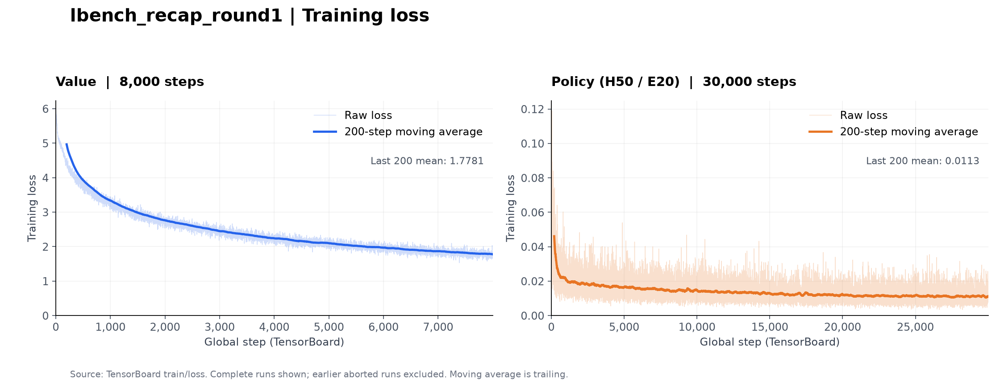

# Rlinf2 — LBench RECAP round1

归档 `/root/autodl-tmp/outputs/lbench_recap_round1` 对应的训练代码、配置、数据准备脚本、运行记录和 loss 曲线。

这轮实验已经完成 **Value 8,000 步**和 **π0.5 CFG Policy 30,000 步**。策略使用三路图像、8 维绝对关节目标，预测 **50 步**、执行 **20 步**。



## 训练结果

| 阶段 | 记录步数 | 最后一步 loss | 最后 200 步平均 loss |
| --- | ---: | ---: | ---: |
| Value | 8,000 | 1.747118 | 1.778106 |
| Policy (H50 / E20) | 30,000 | 0.012213 | 0.011345 |

Value 最后 200 步的目标最大权重档位命中率为 **39.66%**，两个相邻目标档位之一的命中率为 **61.76%**，训练 batch 的 Spearman 相关系数平均为 **0.95810**。这些都是训练指标；本次没有独立验证集，也不能用 loss 代替机器人任务成功率。

- [曲线 PNG](artifacts/lbench_recap_round1/loss_curves.png)
- [全部 38,000 条 loss CSV](artifacts/lbench_recap_round1/loss_curves.csv)
- [loss 汇总 JSON](artifacts/lbench_recap_round1/loss_curves_summary.json)
- [原始 TensorBoard 文件](artifacts/lbench_recap_round1/tensorboard/)
- [压缩训练日志与内存记录](artifacts/lbench_recap_round1/logs/)

曲线横轴沿用 TensorBoard 的从 0 开始的 step：Value 为 0–7999，Policy 为 0–29999。浅色是原始值，深色是向后看的 200 步滑动平均。原始目录中的空事件文件和早期中断运行也保留了，绘图只选择两段完整运行。

## 收录内容和来源

```text
Rlinf2/
├── README.md
├── RLinf/                         # 完整 RLinf 工作树，含未提交的本地修改和新文件
├── configs/
│   ├── recorded/                  # 从最终 Value 日志 / Policy TensorBoard 提取的配置
│   └── current/                   # 归档当天解析的 returns/value/advantages/policy 配置
├── scripts/                       # 路径配置、分阶段启动、画图、完整性检查
├── assets/
│   ├── preparation_manifest.json  # 4493 条轨迹的数据准备清单及统计方法
│   ├── normalization/             # 实际共享 norm、SFT/rollout norm、参考 norm
│   └── dataset_metadata/          # 16 个数据集的任务、统计、阈值等小文件
├── artifacts/
│   ├── lbench_recap_round1/        # 原始事件、loss 图片/CSV、压缩日志
│   ├── checkpoint_metadata/       # 权重关联的 norm 和 openpi_assets.json
│   ├── checkpoint_inventory.json  # 本机 checkpoint 文件清单及完成状态
│   ├── history/                   # 准备、短测、验证、性能测试记录和外部脚本
│   └── inference_export/          # 推理加载/导出脚本、配置、验证记录和当时源码
├── third_party/                   # 本机使用的 OpenPI/LeRobot 和 Transformers 补丁源码
├── environment/                   # 两套 Python 环境的版本记录
├── provenance/                    # 源码 commit、未提交变更、文件来源和 SHA256
└── SHA256SUMS                      # 本次归档文件校验清单
```

源码取自 `Berlin-Law-code/RLinf` 的本地工作树，基础 commit 为
`055e72920f81297c9fcdc8df23ff47990bd5bb76`，归档时间为 **2026-10-26 UTC**。
这是归档时的源码快照，包含训练修复和后续小修改；原运行没有记录逐文件源码哈希，因此不能宣称与训练启动时逐字节一致。具体文件来源见 [provenance/copied_files.json](provenance/copied_files.json)，已有修改见 [source_state.json](provenance/source_state.json) 和 [补丁](provenance/rlinf_tracked_changes.patch)。

`artifacts/history/lbench_recap_preparation/*_resolved.json` 是**准备/短测阶段的历史配置**，其中存在 micro batch=4、Policy 5000 步、测试用 Value checkpoint 等旧值。正式训练以 `configs/recorded/` 为准。原有 `RLinf/examples/offline_rl/LBENCH_RECAP.md` 也保留了当时“只启动 Value”的操作说明；本 README 反映最终已完成的两个训练阶段。

## 实验设置

数据共 **4,493 条轨迹、3,740,411 帧**：1,600 条 SFT 示范和 2,893 条 rollout，来自 8 个任务的两组数据集。

| 阶段 | 关键参数 |
| --- | --- |
| Return | 普通步 -1，成功终点 0，失败终点 -300；gamma=1 |
| Value | SigLIP2 + Gemma3 独立模型；201 档，范围 [-1, 0]；8000 steps |
| Value batch | micro=32/GPU，global=256，2 GPU，梯度累积=4 |
| Value 优化 | lr=5e-5，warmup=500，constant；无独立验证 |
| Advantage | lookahead=20，gamma=1，top 30% 分位数阈值；SFT 标签强制为正 |
| 实际阈值 | `0.002161977479561261`，见各数据集 `meta/mixture_config.yaml` |
| Policy | π0.5 CFG，H50/E20，8 维实际动作，30000 steps |
| Policy batch | micro=16/GPU，global=64，2 GPU，梯度累积=2 |
| Policy 优化 | lr=5e-6，warmup=500，cosine 到 30000 步，min_lr=0 |
| CFG | `positive_only_conditional=true`，`unconditional_prob=0.1` |
| 保存 | Value 每 1000 步、Policy 每 5000 步，各保留最近 3 个完整 checkpoint |

共享动作/状态 norm 的 SHA256：
`d5bb058a07008caec94294965cb20896ee96c1509d0ba466ea35f9b1f835823c`。
它使用 LeRobot 的逐 episode 统计和 5000-bin 直方图分位数汇总，不是把全部帧拼起来调用 `np.quantile`。统计源码、参考 norm 和准备清单均已收录。

## 两个 loss 的含义

**Value**：把轨迹累计回报除以 2399，投影到 [-1, 0] 上的 201 个等间隔档位。若落在两档之间，则按线性权重分配目标概率。模型输出档位概率，以 `-sum(q * log(p))` 的 batch 平均训练。Value 数值由各档位的概率加权平均得到。均匀预测的交叉熵是 `log(201) ≈ 5.3033`。

**Policy**：对归一化动作 `a` 采样噪声 `ε` 和时间 `t`，构造 `x_t = (1-t)*a + t*ε`；模型预测流场，与目标 `ε-a` 计算 MSE。在该 LBench 配置下，对全部 50 个预测步、8 个实际动作维度以及 batch 取平均。

Value 用于生成优势标签；Policy 根据这些标签选择正向引导或普通任务条件。两种 loss 的尺度和含义不同，不能比较数值大小，也都不是成功率。

实现入口：

- [Value loss](RLinf/rlinf/models/embodiment/value_model/recap/modeling_critic.py)
- [Policy loss 与 CFG 条件分配](RLinf/rlinf/models/embodiment/openpi_cfg/openpi_cfg_action_model.py)
- [回报计算](RLinf/examples/offline_rl/advantage_labeling/recap/process/compute_returns.py)
- [优势计算](RLinf/examples/offline_rl/advantage_labeling/recap/process/compute_advantages.py)

## 环境与必须另行准备的资源

训练使用 Python 3.11，PyTorch `2.11.0+cu130`、Transformers `4.57.6`、LeRobot `0.3.3`、`rlinf-openpi==0.1.1`，两张 NVIDIA RTX PRO 6000 Blackwell Server Edition。数据准备另用 LeRobot `0.5.1` 环境。完整版本及依赖源码说明见 [environment/README.md](environment/README.md)。

仓库不含模型权重、优化器状态、训练 parquet、原始视频或虚拟环境。以下资源仍需在本机或新机器准备：

| 资源 | 原机器位置 / 来源 |
| --- | --- |
| 原始 SFT 示范 | `/root/autodl-tmp/datasets/lbench_8tasks_all_merge_simple_v21` |
| 原始 rollout | `/root/autodl-tmp/datasets/round1_success_failure` |
| 准备后的数据 | `/root/autodl-tmp/datasets/lbench_recap_round1` |
| 统计参考 | `/root/autodl-tmp/datasets/lbench_8tasks_all_merge_simple_v21_merged/assets/lerobot_meta_stats/norm_stats.json`；小文件已归档 |
| SigLIP2 | `/root/autodl-tmp/models/siglip2-so400m-patch14-224`，模型标识 `google/siglip2-so400m-patch14-224` |
| Gemma3 / tokenizer | `/root/autodl-tmp/models/gemma-3-270m`，模型标识 `google/gemma-3-270m` |
| 初始 SFT 策略 | `/root/autodl-tmp/outputs/lbench_all_merge_simple_sft_h50_e20_lerobot_norm_20261001_120113/lbench_all_merge_simple_pi05_h50_e20_lerobot_norm/checkpoints/global_step_30000` |
| 完成的 Value | `/root/autodl-tmp/outputs/lbench_recap_round1/value/checkpoints/global_step_8000` |
| 完成的 Policy | `/root/autodl-tmp/outputs/lbench_recap_round1/policy_h50_e20/checkpoints/global_step_30000` |

`artifacts/inference_export/` 保存了导出代码和验证证据，缺少权重时不能直接进行推理。原目录 `stage.txt` 只记录 `complete:value`，不能用它判断后来单独运行的 Policy；Policy 完成状态由 30000 条事件、完整 checkpoint 标记和导出记录交叉确认。

## 在原训练机器运行

先进入新仓库，使用已有训练环境。新生成的配置默认输出到新仓库的 `runs/recap_round1`，不会把结果写回归档的 `artifacts/`。

```bash
cd /root/autodl-tmp/Berlin/Rlinf2
export TRAIN_PYTHON=/root/autodl-tmp/.venvs/rlinf-openpi/bin/python
"$TRAIN_PYTHON" scripts/configure.py

# 数据已准备完毕时，依次执行需要的阶段。
bash scripts/run_stage.sh returns
bash scripts/run_stage.sh value
bash scripts/run_stage.sh advantages
bash scripts/run_stage.sh policy
```

若只重训 Policy，使用原有的已计算优势标签即可执行 `policy`。若仅重新计算优势，可在生成配置时指定已完成的 Value：

```bash
"$TRAIN_PYTHON" scripts/configure.py \
  --value-checkpoint /root/autodl-tmp/outputs/lbench_recap_round1/value/checkpoints/global_step_8000
bash scripts/run_stage.sh advantages
```

迁移机器时替换路径：

```bash
python scripts/configure.py \
  --data-root /data/datasets \
  --models-root /data/models \
  --initial-policy /data/checkpoints/initial_sft/global_step_30000 \
  --output-root /data/outputs/recap_round1
```

`--data-root` 是包含 `lbench_recap_round1/` 的父目录。配置生成器只改路径，Value/Policy 的 batch、步数、学习率等参数来自记录的正式配置。Return/Advantage 使用归档时的配置；原正式 Advantage 启动参数没有完整日志，实际阈值已从数据集元数据保留。

`scripts/run_stage.sh` 支持追加 Hydra overrides；它负责单阶段启动，不自动启用原启动器的文件锁和内存监控。原始完整流水线和监控代码仍在 [run_lbench_recap.sh](RLinf/examples/offline_rl/run_lbench_recap.sh)。

从原始数据重新准备时，使用独立的 LeRobot 0.5.1 环境运行 `RLinf/toolkits/lerobot/prepare_lbench_recap.py`。该原脚本的源数据和参考路径保留了原机器值；迁移时需修改副本中的 `DATA_ROOT`，并将准备环境的 `PYTHONPATH` 指向 `third_party/lerobot_preparation/src`。脚本拒绝覆盖已有 preparation manifest。

## 查看曲线和检查归档

只查看/重画 loss 不需要 GPU、机器人环境或模型权重：

```bash
python -m pip install numpy matplotlib tensorboard
python scripts/plot_losses.py
# 新结果默认保存到 runs/loss_plots，不覆盖归档原图。

tensorboard --logdir artifacts/lbench_recap_round1/tensorboard
python scripts/verify_snapshot.py
```

原 TensorBoard 目录里两个阶段都用了 `train/loss`，而且包含重启记录；直接打开时可能混在同一个 run。`plot_losses.py` 按 Value/Policy 指标识别阶段，并选择训练步数最多的完整运行。

## 验证范围与许可证

本次归档检查源码/原始记录 SHA256、gzip 解压一致性、共享 norm、loss CSV 与原始事件一致性、配置生成和 Hydra 解析、脚本语法。没有重新执行 8000/30000 步训练，也没有声称已在全新环境完成端到端复现。

RLinf 及各依赖原有许可证和版权声明均保留。根目录 [LICENSE](LICENSE) 来自 RLinf；第三方许可证见 [third_party/licenses/](third_party/licenses/) 以及 `third_party/lerobot_preparation/LICENSE`。已安装 OpenPI 分发包附带的 Gemma 许可文本也保留在许可证目录。

