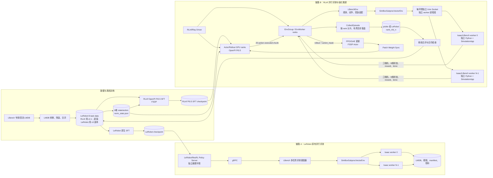
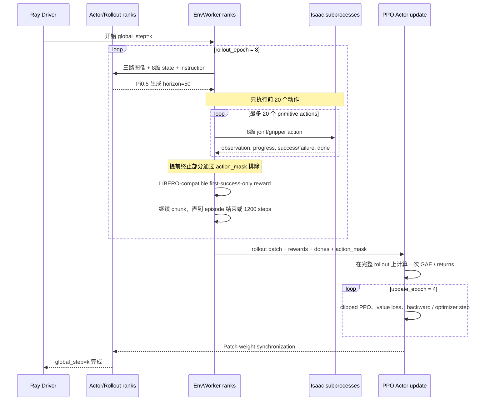
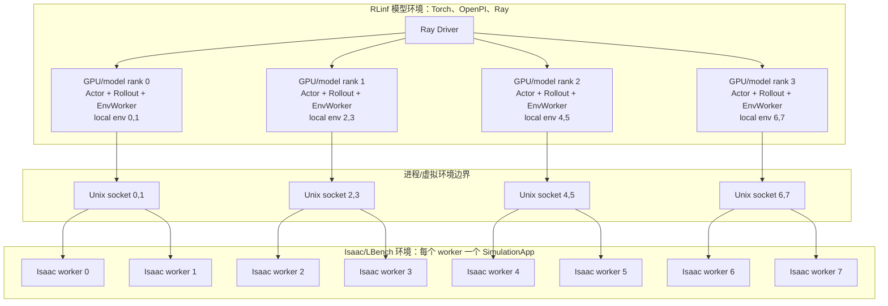

# LBench × LeRobot × RLinf 当前架构图

本文描述当前代码中的两条并存链路：

- LeRobot checkpoint 的原生并行评测链路使用 gRPC；
- RLinf Pi0.5 的 SFT、并行评测和 PPO 链路由 RLinf `EnvWorker` 通过 Unix
  domain socket 直接管理隔离的 Isaac/LBench 子进程。

LeRobot 源码不属于本次改动范围。RLinf 和 Isaac 使用不同 Python 环境，模型侧
GPU 与仿真侧 GPU 也必须显式隔离。

## 华丽版总览

该 SVG 使用不同颜色表示不同数据流：青色为 observation/数据，紫色为模型，
橙色为动作与仿真，绿色为 PPO/数据回流，粉色为 LeRobot 原有 gRPC 评测链路。

## 1. 整体架构

## 2. PPO 一个 global step 的闭环

这里的两个计数不是一回事：

- `rollout_epoch=8`：每个 PPO `global_step` 收集 8 轮 rollout；
- `runner.max_steps=200`：最多进行 200 个“收集后再更新”的全局闭环。

## 3. 正式 8 环境、4 模型 GPU 的逻辑部署

`GPU/model rank 0` 没有特殊的仿真职责；它只是分布式模型组的第一个 rank，通常
还承担日志、checkpoint 或集合通信中的协调工作。每个 `EnvWorker rank` 只负责
自己分到的局部环境，并为每个局部环境启动一个 Isaac 子进程。

每个外部 Isaac worker 使用独立进程组；超时或异常时会连同辅助进程一起清理。
长 episode 的异步导出队列也设置了上限，编码或磁盘变慢时通过背压限制内存增长。

模型 GPU 集合与 Isaac GPU 集合必须不重叠。例如模型侧使用 4 张卡、仿真侧使用
8 张卡时，可分别通过 RLinf 的 `CUDA_VISIBLE_DEVICES` 和
`LBENCH_ISAAC_GPUS` 显式指定。上图是逻辑进程映射，不代表已经在目标硬件上完成
显存和吞吐量验证。

## 4. 两种通信方式的边界

| 场景 | 模型在哪里 | 环境通信 | 是否经过 LeRobot gRPC |
|---|---|---|---|
| LeRobot checkpoint 并行评测 | LeRobot/ResRL policy server | LBench client 到 policy server 使用 gRPC；仿真 worker 由 LBench 多进程管理 | 是 |
| RLinf checkpoint 并行评测 | RLinf Actor/Rollout ranks | `EnvWorker -> LBenchEnv -> Unix Socket -> Isaac worker` | 否 |
| RLinf Pi0.5 PPO | RLinf Actor/Rollout ranks | 同上，额外回传 reward、done、`action_mask` | 否 |
| RLinf Pi0.5 SFT | RLinf FSDP Actor | 读取与当前 loader 匹配的 LeRobot 数据（当前为 v2.1），不启动 Isaac | 否 |

较早里程碑曾完成静态编译和 CPU/mock 合同检查；本轮 v2.1 数据、转换器及超时语义
加固后，按要求没有在当前机器重新运行测试。真实 Pi0.5、Ray 多 GPU、Isaac
SimulationApp 与端到端 checkpoint 仍需在资源足够的机器上分阶段验证。
